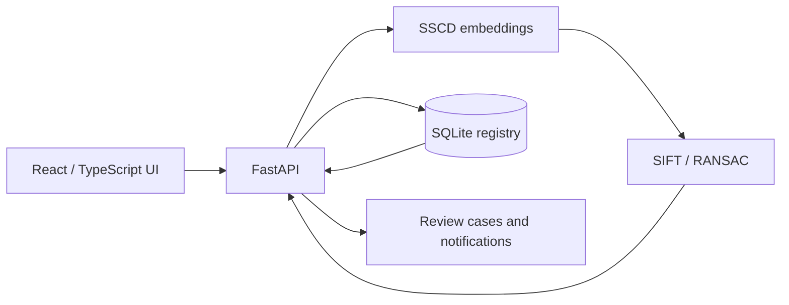

# ATHN (إذن / IDHN)

**AI-assisted image-rights verification before marketplace publication.**

ATHN is a LegalTech hackathon prototype that detects potential copies of registered product photographs, checks recorded seller permissions, and routes uncertain or unauthorized use to human review. Its Arabic interface connects sellers, rights holders and reviewers to a persistent AI backend.

> Prototype only: the rights registry and marketplace are simulated. ATHN does not establish legal infringement or represent an official integration with the Saudi Authority for Intellectual Property (SAIP).

## What it does

- Register new photographs, generate 512-dimensional SSCD embeddings and make them searchable immediately.
- Identify likely copies, including cropped, rotated, compressed and overlaid versions, using SSCD similarity and SIFT/RANSAC geometric verification.
- Check seller identity and permission records before returning an allow, review or hold-for-review decision.
- Record verification evidence, send internal notifications, and support human review with persistent audit records.
- Allow rights holders to grant and revoke permissions through the existing Arabic dashboard.

## Architecture



| Layer | Stack |
| --- | --- |
| Frontend | React, TypeScript, Vite, TanStack Query |
| Backend | Python 3.11, FastAPI, Uvicorn |
| Image retrieval | PyTorch, pretrained SSCD Disc Mixup |
| Geometric verification | OpenCV SIFT and RANSAC |
| Persistence | SQLite and image files |

## Repository

```text
Athn/
├── frontend/       # Arabic UI, service contracts, existing tests
├── backend/        # AI API, registration, auth, permissions, review
├── research/       # Colab source export, thresholds, aggregate results
├── docs/           # Setup, dataset, architecture and original UI design
├── LICENSE
└── README.md
```

The dataset, pretrained weights, embeddings, original research notebook with outputs, and private runtime files are **not committed**. Authorized collaborators can obtain the required assets from the [ATHN Google Drive folder](https://drive.google.com/drive/folders/1LRAvdL-bINHn_J3GLlWBMCYhTVNmJtwE). Access is managed separately; the link does not make the folder public.

## Quick start

1. Clone `https://github.com/MuathLoss/Athn.git`.
2. Restore the required runtime assets into `ATHN_runtime/` at the repository root.
3. Configure four local account passwords in `backend/.env` and install Python dependencies.
4. Start FastAPI on port 8000, then Vite on port 5173 using the provided frontend environment template.
5. Open `http://127.0.0.1:5173`.

See [complete setup instructions](docs/SETUP.md), including CPU/GPU installation, seed data, account identifiers and smoke tests. The [external asset inventory](docs/EXTERNAL_ASSETS.md) lists the exact files and recovery locations.

The application protects photographs rather than product identity; our local example recognized exact and edited copies while allowing an independently taken photograph of the same product.

## Research results

The research corpus contains 55,000 images: 5,000 reference photographs, 5,000 same-product candidates, 20,000 unrelated candidates and 25,000 synthetic manipulations. The held-out manipulated-image benchmark contains 15,000 queries.

| Metric | Held-out manipulated queries |
| --- | ---: |
| Top-1 retrieval | 94.66% |
| Top-3 retrieval | 97.33% |
| Top-5 retrieval | 97.99% |
| Flagged for review or hold | 94.65% |
| Correct source identified and flagged | 91.15% |

The [aggregate results CSV](research/results/final_performance.csv) reports results by manipulation type. Combined manipulations are harder than compression, rotation, overlay or cropping individually. Same-product and unrelated candidate sets contain possible duplicate photographs; their escalation rates must not be interpreted as verified false-positive rates. Independent negative testing is still required.

## Status

The local demonstration exercised dynamic registration, authorized and unauthorized seller decisions, notifications, reviewer evidence, human decision and audit persistence, and a tested role restriction. The reorganized repository includes configuration and security changes that require a fresh local smoke test before deployment. Production security, comprehensive evaluation and a real registry/marketplace integration remain outside this prototype.

## Documentation

- [Setup and recovery](docs/SETUP.md)
- [Architecture and API](docs/ARCHITECTURE.md)
- [Dataset and research](docs/DATASET.md)
- [External assets and private backups](docs/EXTERNAL_ASSETS.md)
- [Original frontend design references](docs/ui-inspiration.md)

## License

All Rights Reserved for newly contributed material, subject to prior grants and third-party licenses. See [LICENSE](LICENSE) and the [legacy MIT notice](LICENSES/LEGACY-MIT.txt).
