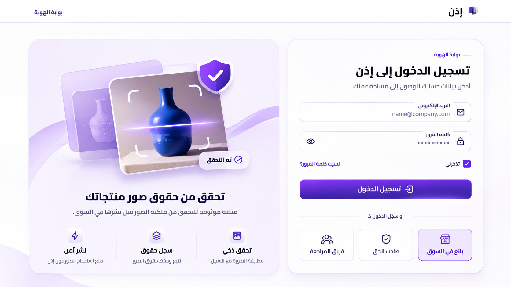
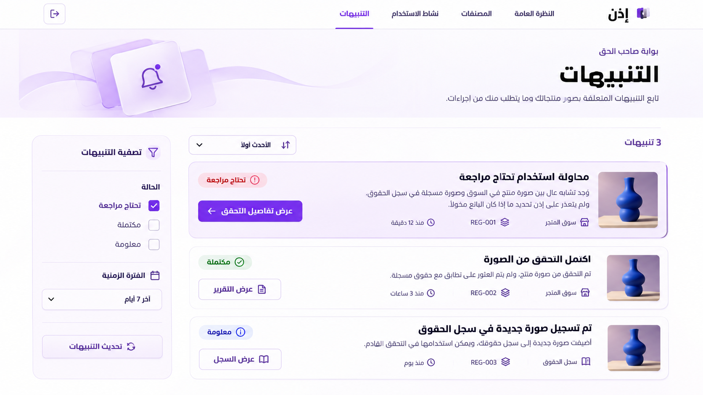
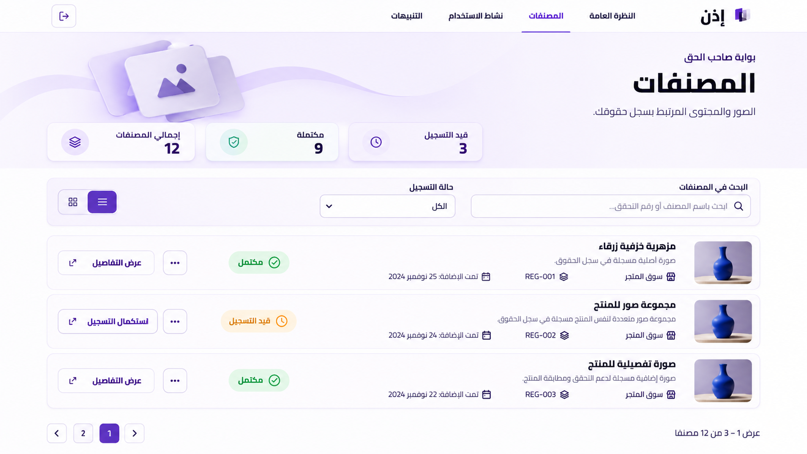
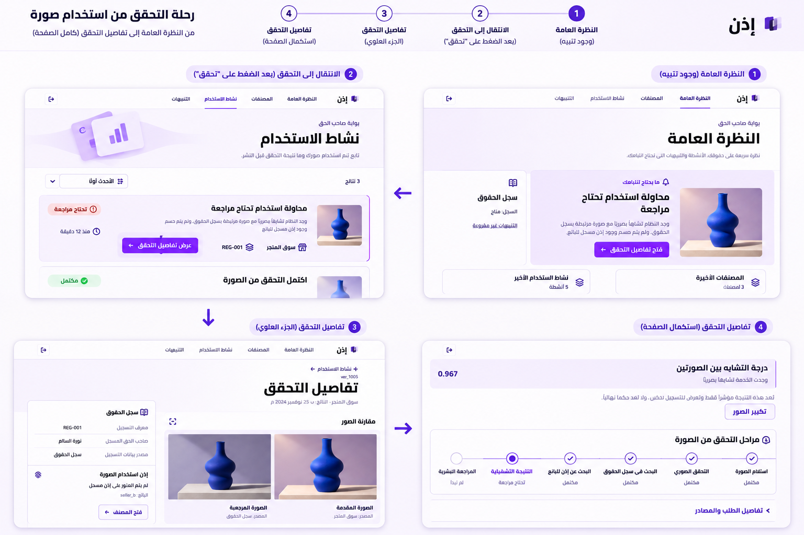
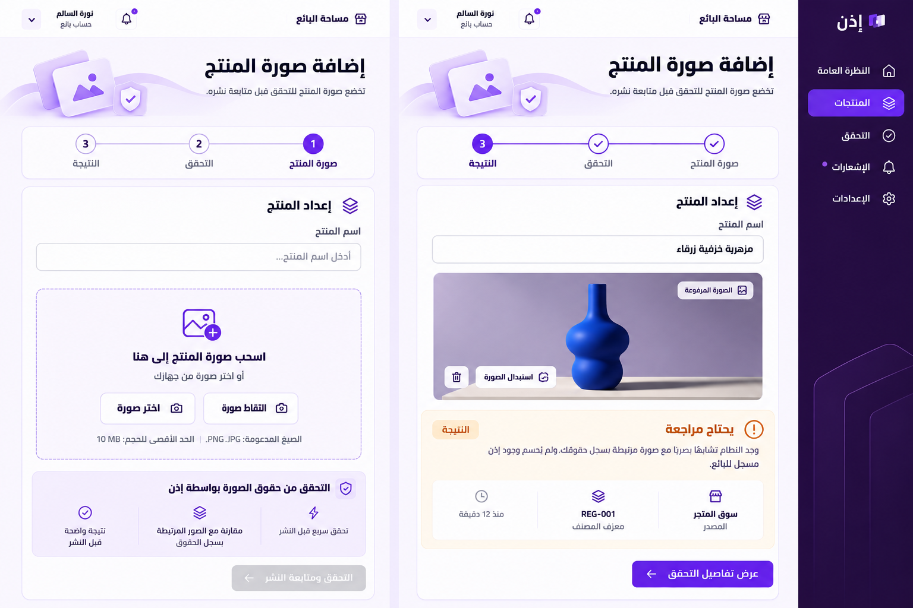
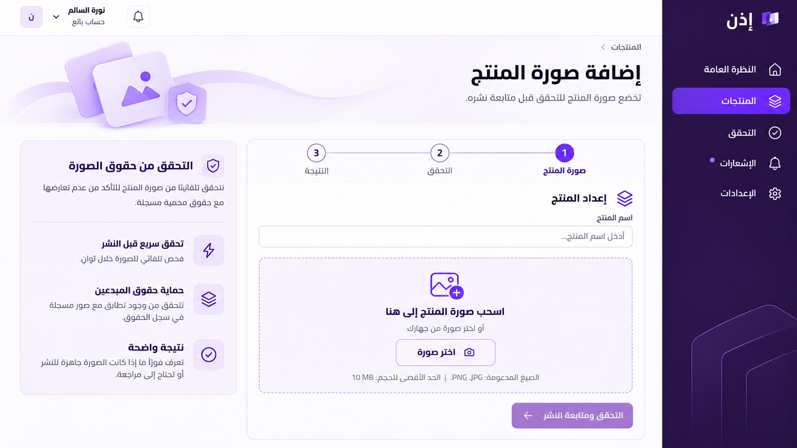

# مراجع تحسين واجهات «إذن»

تُضاف المراجع حسب ترتيب إرسالها. يبدأ التنفيذ عند طلب المستخدم «نفّذ».

## 01 — تسجيل الدخول · `/login`

### Prompt

Design a refined high-fidelity Arabic RTL web login page concept for the platform "إذن". Keep the same overall product identity and purpose, but improve the current screen substantially so it feels polished, premium, and production-ready. The page should be a desktop UI mockup with a very clean modern layout, subtle visual richness, and better composition than the current version.

Style and art direction:

- Elegant Arabic SaaS / government-tech interface
- Minimal and clean, but not empty or plain
- White is the main base color, supported by very light lavender and soft purple accents
- Add subtle background treatments: faint gradient glow, delicate line-work, soft geometric framing, and very light decorative strokes so the page feels designed, not like a plain document
- Premium, calm, trustworthy, modern
- Soft shadows, gentle borders, tasteful depth
- High readability and polished spacing

Layout:

- RTL Arabic interface
- Top navigation/header with the "إذن" logo on the right and a small breadcrumb or section label on the left
- Main hero/login card centered in a large elegant panel
- Two-column composition inside the main card:
  1) Right side: login content
  2) Left side: visual illustration / abstract brand scene

Login content requirements:

- Large Arabic heading: "تسجيل الدخول"
- Supporting text explaining that the user enters email and password to access the workspace
- Real login form fields, not just a CTA:
  - email field labeled "البريد الإلكتروني"
  - password field labeled "كلمة المرور"
- Password visibility icon inside the password field
- Primary button: "تسجيل الدخول"
- Small supporting secure-login note below
- Make the content feel complete and realistic, not empty

Illustration / visual area:

- Use an abstract branded composition inspired by layered translucent panels/cards with a small central identity symbol
- Soft purple tones, subtle line passing through the composition, and elegant depth
- Keep it visually premium and cohesive with the product identity
- It should enhance the page without overpowering the login form

Bottom information strip:

- Inside the same card, add three concise feature/value blocks with small icons:
  - "التحقق من الهوية" with a short subtitle like "دخول موثوق"
  - "تحديد الصلاحيات" with a short subtitle like "حسب دور الحساب"
  - "فتح مساحة العمل" with a short subtitle like "إجراءات المراجعة قبل النشر"
- These should look well structured and beautifully integrated

Important improvements:

- Make the page more visually rich than the current design while preserving simplicity
- Fix the feeling of emptiness by improving composition, hierarchy, decorative details, and section balance
- Ensure the result feels like a real polished website screen, not a wireframe
- Keep Arabic typography strong and elegant
- Ensure the screen looks like a realistic final UI mockup that can be handed to a developer

Output:

- Single static UI mockup
- High fidelity
- Desktop aspect ratio
- Clean Arabic typography
- No watermarks

### ملاحظة للتنفيذ لاحقًا

الصورة مرجع بصري. يظل الدور آتيًا من جلسة المصادقة وفق متطلبات المشروع. تخضع وظائف تذكّر الدخول واستعادة كلمة المرور لعقد المصادقة المعتمد.

## 02 — التنبيهات · `/portal/notifications`

### Prompt

طوّر شاشة **التنبيهات** الحالية في «إذن» بناءً على نفس الوظائف والبيانات الموجودة، لكن ارفعها بصريًا وتجريبيًا لتصبح أقرب لواجهة Product حقيقية، لا مجرد بطاقة واحدة داخل مساحة بيضاء كبيرة.

استخدم الصورة المرجعية المرفقة كـ **Visual Direction فقط**، لا تنسخها حرفيًا.

#### الهدف

حوّل الشاشة من:

- عنوان
- بطاقة تنبيه واحدة
- فراغ أبيض كبير

إلى: **Operational Notifications Inbox**

تسمح لصاحب الحق بفهم:

- ما الذي حدث؟
- أي صورة أو مصنف مرتبط؟
- ما حالة التنبيه؟
- هل يحتاج إجراء؟
- متى حدث؟
- ما الخطوة التالية؟

---

#### 1. Header / Hero

احتفظ بعنوان: **التنبيهات**

وتحته وصف واضح مثل: **تابع التنبيهات المرتبطة بصورك والمصنفات التي تحتاج انتباهك.**

أضف خلفية بصرية خفيفة جدًا:

- soft lavender field
- verification trace lines
- layered identity geometry
- bell / event motif خفيف

الأبيض يبقى الأساس.

---

#### 2. قائمة التنبيهات

لا تعرض التنبيه كـstrip طويل فقط.

استخدم قائمة متعددة الصفوف أو البطاقات التشغيلية بحيث يحتوي كل تنبيه على:

- thumbnail للصورة إن كانت متاحة
- عنوان التنبيه
- وصف مختصر للسبب
- اسم السوق أو المصدر
- معرف التحقق / المصنف عند الحاجة
- الوقت
- حالة التنبيه
- CTA واضح

مثال للحالة المهمة:

**محاولة استخدام تحتاج مراجعة**

وصف: **وجد النظام تشابهًا بصريًا مع صورة مرتبطة بسجل حقوقك، ولم يُحسم وجود إذن مسجل للبائع.**

الإجراء: **عرض تفاصيل التحقق**

---

#### 3. حالات التنبيه

اعرض الحالات بصريًا، لكن لا تعتمد على اللون فقط.

مثل:

- يحتاج مراجعة
- مكتمل
- معلومة
- مقروء / غير مقروء

استخدم:

- icon
- label
- subtle color
- typography hierarchy

ولا تستخدم pills كثيرة بلا داعٍ.

---

#### 4. Filters

أضف منطقة تصفية خفيفة ومفيدة، مثل:

- الحالة
- الفترة الزمنية
- unread/read عند الحاجة

يفضل أن تكون compact ولا تستهلك الشاشة.

لا تضف filters غير مدعومة بالبيانات الحالية.

---

#### 5. Visual Density

المشكلة الحالية هي الفراغ الكبير.

حلها عن طريق:

- قائمة أكثر كثافة
- توزيع أفضل للمحتوى
- contextual side filter أو top filter
- thumbnails
- metadata
- subtle background structure

لا تضف بيانات وهمية فقط لملء الشاشة.

إذا كانت البيانات الحالية تحتوي تنبيهًا واحدًا فقط، حافظ على نفس البيانات، لكن صمّم الـlayout بحيث يدعم قائمة متعددة مستقبلاً.

---

#### 6. Visual Language

استخدم لغة «إذن»:

- Royal Purple accents
- soft lavender
- verification lines
- small decision nodes
- thin structural borders
- provenance icons
- layered geometry

تجنب:

- generic SaaS cards
- heavy gradients
- random blobs
- neon
- glassmorphism مبالغ

---

#### 7. النصوص

راجع النصوص لتكون مفهومة لشخص غير تقني.

لا تكتب فقط: **محاولة استخدام تحتاج مراجعة**

بل وضح السبب في سطر ثانٍ.

لا تستخدم:

- مصطلحات داخلية
- jargon
- wording يوحي بحكم قانوني قطعي

---

#### 8. Responsive

على Desktop:

- يمكن استخدام sidebar/filter rail أو toolbar
- القائمة تستفيد من العرض

على Mobile:

- تتحول التنبيهات إلى stacked rows/cards
- الصورة تبقى مرئية
- CTA واضح
- metadata تختصر بذكاء
- لا horizontal overflow

---

#### 9. Motion

استخدم فقط microinteractions خفيفة:

- unread → read
- opening details
- filter transition
- hover/focus

احترم reduced motion.

---

#### 10. لا تغيّر الوظيفة

لا تضف:

- backend logic
- notification policy
- legal logic
- new actions غير موجودة في Sources

التعديل المطلوب بصري وتجريبي فقط.

بعد التنفيذ:

- شغّل build
- lint
- typecheck
- tests
- visual QA

ثم أعطني Closure Report مختصر يتضمن:

- ما الذي تغير بصريًا
- ما الذي تغير في النصوص
- كيف قللت الفراغ الأبيض
- كيف حسّنت قابلية قراءة التنبيهات

## 03 — المصنفات · `/portal/works`

### Prompt

طوّر شاشة **المصنفات** الحالية في «إذن» لتصبح **Registry Ledger / Rights Catalog** واضحة وغنية بصريًا، مستلهمة من الصورة المرجعية المرفقة، مع الحفاظ على نفس الوظائف والبيانات الموجودة في المشروع.

استخدم الصورة المرجعية كـ **Visual Direction فقط**، ولا تنسخها حرفيًا.

#### الهدف

حوّل الشاشة من:

- عنوان
- بحث
- فلتر
- صف واحد
- مساحة بيضاء كبيرة

إلى:

**سجل حقوق تشغيلي منظم** يساعد صاحب الحق على:

- رؤية جميع المصنفات المرتبطة به.
- معرفة حالة كل مصنف.
- رؤية آخر نشاط مرتبط به.
- الوصول إلى التفاصيل بسرعة.
- فهم مصدر التسجيل وحالة البيانات.

---

#### 1. Header / Hero

احتفظ بعنوان: **المصنفات**

والوصف: **الصور والمحتوى المرتبط بسجل حقوقك.**

أضف Visual Header خفيف يحتوي على:

- soft lavender atmosphere
- layered image/content motif
- خطوط Verification / Registry خفيفة
- geometry مستوحاة من هوية «إذن»

الأبيض يبقى الأساس.

---

#### 2. Summary

إذا كانت البيانات الحالية تدعم counts حقيقية، أضف ملخصًا صغيرًا مثل:

- إجمالي المصنفات
- مكتملة
- قيد التسجيل / تحتاج استكمال

لا تضف أرقامًا وهمية.

إذا لم تكن counts متاحة من Service Layer، لا تخترعها.

تجنب KPI cards التقليدية قدر الإمكان؛ استخدم summary blocks خفيفة ومتكاملة مع الصفحة.

---

#### 3. Search & Filters

حسّن منطقة البحث والتصفية بحيث تكون compact وواضحة.

استخدم فقط الفلاتر المدعومة حاليًا، مثل:

- البحث بالاسم أو معرف التسجيل
- حالة التسجيل

يمكن إضافة:

- sort by latest activity
- list/grid toggle

فقط إذا كانت الوظيفة والبيانات تدعم ذلك بالفعل.

---

#### 4. Registry Ledger Rows

حوّل كل مصنف إلى Row غني بدل صف نصي بسيط.

كل row يمكن أن يتضمن:

- thumbnail واضحة
- اسم المصنف
- registration/reference ID
- مصدر التسجيل
- حالة التسجيل
- آخر نشاط مرتبط
- آخر تحديث / تاريخ
- CTA:
  - عرض التفاصيل
  - استكمال التسجيل، إذا كان هذا state موجودًا فعليًا

لا تضف Actions غير موجودة في Sources.

---

#### 5. Visual Hierarchy

اجعل أهم العناصر بالترتيب:

1. الصورة
2. اسم المصنف
3. حالة التسجيل
4. مصدر التسجيل
5. آخر نشاط
6. الإجراءات

استخدم:

- strong typography
- subtle borders
- small provenance icons
- semantic status cues
- thin structural separators

---

#### 6. Status Design

اعرض حالات التسجيل بصريًا باستخدام:

- icon
- label
- subtle semantic color

مثل:

- مكتمل
- قيد التسجيل
- يحتاج استكمال

لكن لا تعتمد على اللون وحده.

ولا تكثر من pills.

---

#### 7. Visual Density

المشكلة الحالية الرئيسية هي الفراغ الكبير.

قلل الإحساس بالفراغ عبر:

- ledger rows أكثر وضوحًا
- metadata
- thumbnails
- structured header
- summary
- filters
- subtle background linework
- light lavender zones

لا تضف بيانات مزيفة فقط لملء الشاشة.

إذا كانت البيانات الحالية تحتوي على مصنف واحد فقط، صمّم الـlayout بحيث يدعم عدة مصنفات مستقبلاً بدون اختراع entries جديدة.

---

#### 8. لغة «إذن» البصرية

استخدم:

- Royal Purple
- Soft Lavender
- Content Layers
- Registry / Verification linework
- thin geometric frames
- subtle depth
- provenance/source icons

تجنب:

- generic SaaS table
- blank white canvas
- heavy cards
- neon
- random gradient blobs
- glassmorphism مبالغ

---

#### 9. النصوص

راجع النصوص لتكون واضحة.

لا تكتفِ بمصطلحات مثل:

**المصنف**

**التسجيل**

**السجل**

بدون سياق.

استخدم helper text عند الحاجة مثل: **الصور والمحتوى المرتبط بسجل حقوقك.**

حافظ على المصطلحات القانونية المعتمدة، لكن اجعلها مفهومة للمستخدم.

---

#### 10. Responsive

Desktop:

- ledger واسع
- الفلاتر واضحة
- الصور والmetadata تستفيد من المساحة

Mobile:

- كل مصنف يتحول إلى compact stacked entry
- الصورة تبقى واضحة
- الحالة ظاهرة
- CTA واضح
- metadata تختصر بذكاء
- لا horizontal overflow

---

#### 11. Motion

استخدم motion خفيف فقط:

- hover/focus
- filter changes
- opening work details
- transition من row إلى Work Details عند الإمكان

احترم: `prefers-reduced-motion`

---

#### 12. لا تغيّر المنطق

لا تضف:

- registry truth جديدة
- legal conclusions
- authorization logic
- new registration workflow غير موجود
- fake activity

الواجهة فقط تعرض بيانات Service Layer الحالية.

بعد التنفيذ:

- شغّل build
- lint
- typecheck
- tests
- visual QA

ثم أعطني Closure Report مختصر يتضمن:

- كيف تحولت الشاشة إلى Registry Ledger
- كيف قللت الفراغ الأبيض
- ما الذي تغير في الـhierarchy
- ما الذي تغير في النصوص
- كيف استخدمت الصور والmetadata
- نتائج الاختبارات

## 04 — رحلة التحقق · `/portal` → `/portal/verifications/:verificationId`

### Prompt

طوّر الرحلة البصرية والوظيفية بين:

**النظرة العامة → فتح تفاصيل التحقق → تفاصيل التحقق (الجزء العلوي) → استكمال تفاصيل التحقق**

استلهم من الصورة المرجعية المرفقة كـ **Visual Direction فقط**، ولا تنسخها حرفيًا.

#### الهدف

أريد المستخدم يفهم بوضوح كيف ينتقل من وجود تنبيه في النظرة العامة إلى فتح حالة تحقق كاملة، ويرى العلاقة بين:

**الصورة المقدمة → الصورة المرجعية → سجل الحقوق → الإذن → نتيجة النظام → المراجعة البشرية**

الرحلة يجب أن تبدو مترابطة، لا أربع صفحات منفصلة.

---

#### 1. النظرة العامة

داخل منطقة: **ما يحتاج انتباهك**

حسّن الحالة الرئيسية بحيث تعرض:

- الصورة المقدمة بشكل واضح
- الصورة المرجعية بشكل أصغر إذا كانت متاحة
- اسم المصنف
- اسم السوق
- سبب الحاجة للمراجعة
- حالة النشر
- mini verification trace
- CTA واضح: **فتح تفاصيل التحقق**

صياغة الحالة يجب أن تكون مفهومة، مثل:

**محاولة استخدام تحتاج مراجعة**

ووصف مختصر: **وجد النظام تشابهًا بصريًا مع صورة مرتبطة بسجل حقوقك، ولم يُحسم وجود إذن مسجل للبائع.**

لا تجعل المنطقة نصية فقط.

---

#### 2. الانتقال إلى تفاصيل التحقق

عند الضغط على: **فتح تفاصيل التحقق**

استخدم انتقال يحافظ على السياق البصري.

يفضل:

- shared image transition
- shared verification trace
- subtle content morph
- preserve spatial continuity

لا تستخدم انتقال fade عادي فقط إذا كان المتصفح يسمح بحل أفضل.

احترم reduced motion.

---

#### 3. الجزء العلوي من تفاصيل التحقق

اجعل أول ما يراه المستخدم:

##### مقارنة الصور

- الصورة المقدمة
- الصورة المرجعية
- source label ملاصق لكل صورة
- إمكانية تكبير الصور إذا كانت الوظيفة موجودة

ثم:

##### خلاصة الحالة

اعرض:

- النتيجة التشغيلية
- حالة المراجعة
- درجة التشابه البصري كإشارة ثانوية
- سبب وصول الحالة للمراجعة

لا تجعل `0.967` Hero أكبر من الأدلة نفسها.

---

#### 4. Registry + Authorization Context

اعرض بجانب مقارنة الصور أو أسفلها مباشرة:

##### سجل الحقوق

- معرف التسجيل
- صاحب الحق
- مصدر بيانات التسجيل

##### الإذن

- هل وجد إذن مسجل؟
- البائع المرتبط بالحالة
- حالة البيانات

فرّق بصريًا بين:

- registry truth
- authorization record
- AI evidence
- system recommendation

---

#### 5. مراحل التحقق

طوّر الـtimeline الحالي إلى **Verification Trace** أوضح.

المراحل:

1. استلام الصورة
2. التحقق البصري
3. البحث في سجل الحقوق
4. البحث عن إذن للبائع
5. النتيجة التشغيلية
6. المراجعة البشرية

لكل مرحلة:

- state
- short label
- source/provenance عند الحاجة
- completed / pending / unavailable

لا تجعلها مجرد دوائر متساوية بلا معنى.

---

#### 6. استكمال الصفحة

بعد الجزء العلوي، أكمل الصفحة بطريقة Progressive Disclosure.

استخدم Section واضح مثل:

**تفاصيل الطلب والمصادر**

ويحتوي عند الحاجة على:

- verification ID
- marketplace
- seller
- timestamp
- notification state
- source metadata
- audit-related fields المسموح عرضها

لا تعرض كل التفاصيل الثقيلة من البداية.

---

#### 7. Visual Composition

الأبيض يبقى الأساس، لكن استخدم:

- subtle lavender fields
- trace lines
- content layers
- thin structural borders
- source annotations
- image relationship lines
- small state nodes
- light depth

المطلوب أن تحس الصفحة كـ **Evidence Workspace**، مو مجرد cards متتالية.

---

#### 8. النصوص

اجعل النصوص مفهومة لشخص غير تقني.

مثلاً: بدل **تعليق النشر للمراجعة** يمكن حسب السياق أن يكون: **تم تعليق النشر مؤقتًا لحين مراجعة الحالة**

ولا تستخدم صياغات توحي بأن AI أثبت تعديًا قانونيًا.

`similarity_score` يبقى: **درجة تشابه بصري**

وليس:

- نسبة سرقة
- احتمال انتهاك

---

#### 9. Responsive

Desktop:

- comparison central
- registry / authorization context قريب
- trace كامل

Mobile:

- الصور stacked
- source labels ملاصقة
- trace يتحول لترتيب عمودي
- metadata progressive disclosure
- لا horizontal overflow

---

#### 10. لا تغيّر المنطق

لا تضف:

- thresholds
- legal conclusions
- new authorization logic
- reviewer permissions
- registry truth

اعرض فقط ما يأتي من Service Layer الحالية.

بعد التنفيذ:

- build
- lint
- typecheck
- tests
- visual QA

ثم أعطني Closure Report يتضمن:

- كيف أصبح الانتقال من Overview إلى Verification مترابطًا
- ما الذي تغير في مقارنة الصور
- كيف أصبح الـVerification Trace أوضح
- كيف تغيرت النصوص
- كيف تم تحسين الجزء السفلي من الصفحة
- نتائج الاختبارات

## 05 — واجهة البائع · `/marketplace/pre-publish`

### Prompt — إضافة صورة المنتج

طوّر شاشة **إضافة صورة المنتج** الخاصة بالبائع لتصبح واجهة Marketplace احترافية ومتكاملة، مستلهمة من الصورة المرجعية المرفقة، مع الحفاظ على نفس رحلة البائع والمنطق الموجود في المشروع.

استخدم الصورة المرجعية كـ **Visual Direction فقط**، ولا تنسخها حرفيًا.

#### الهدف

حوّل الشاشة الحالية من:

- عنوان
- حقل اسم المنتج
- مربع رفع صورة
- لوحة تحقق صغيرة

إلى: **Seller Product Publishing Workspace**

بحيث يفهم البائع بوضوح:

1. أضف بيانات المنتج
2. ارفع صورة المنتج
3. يتم التحقق من الصورة بواسطة «إذن»
4. تظهر النتيجة
5. يمكن متابعة النشر أو يتم تعليق الحالة للمراجعة

---

#### 1. Seller Workspace

هذه الشاشة تخص **البائع داخل منصة التجارة** وليست بوابة صاحب الحق.

يجب أن يظهر بوضوح أنها مساحة البائع، مثل: **مساحة البائع**

مع بيانات الحساب الحالية من Session إن كانت متاحة.

لا تجعل الواجهة تبدو كصفحة مستقلة غريبة عن النظام.

يمكن أن تحتوي على Navigation جانبي أو علوي بسيط يوضح:

- النظرة العامة
- المنتجات
- التحقق
- الإشعارات
- الإعدادات

لكن فقط إذا كان ذلك مناسبًا لبنية التطبيق الحالية ولا يضيف وظائف غير موجودة.

---

#### 2. Header

استخدم عنوانًا واضحًا: **إضافة صورة المنتج**

والوصف: **تخضع صورة المنتج للتحقق قبل متابعة نشره.**

أضف Header بصري خفيف:

- soft lavender field
- content/image layers
- verification line
- logo-derived geometry

الأبيض يبقى الأساس.

---

#### 3. Product Preparation

أنشئ مساحة واضحة بعنوان: **إعداد المنتج**

وتحتوي على:

- اسم المنتج
- image upload area
- drag & drop
- اختيار صورة
- التقاط صورة إذا كانت الوظيفة الحالية تدعمها
- preview بعد الاختيار
- replace/remove controls

لا تضف حقول Product جديدة غير موجودة في النظام الحالي.

---

#### 4. Upload Area

اجعل منطقة الرفع واضحة بصريًا وليست مجرد مستطيل رمادي.

استخدم:

- dashed subtle border
- image icon
- helper text
- supported format text إذا كانت القيود موجودة فعلًا في الكود
- hover / drag-over state
- keyboard accessible file selection

قبل اختيار الصورة:

**اسحب صورة المنتج إلى هنا**

أو: **اختر صورة من جهازك**

بعد اختيار الصورة:

- اعرض Preview واضحة
- اسم الملف عند الحاجة
- استبدال الصورة
- إزالة الصورة
- التقاط صورة إذا كان مدعومًا

---

#### 5. IDHN Verification Panel

أضف لوحة سياقية واضحة بعنوان: **التحقق من حقوق الصورة بواسطة إذن**

يجب أن تبدو كخدمة تحقق مدمجة داخل Marketplace.

اعرض رحلة مختصرة: **صورة المنتج → التحقق → النتيجة**

قبل الرفع:

- المرحلة الحالية = صورة المنتج

أثناء التحقق:

- المرحلة الحالية = التحقق

بعد وصول النتيجة:

- المرحلة الحالية = النتيجة

استخدم:

- Royal Purple
- IDHN symbol
- verification trace
- small state nodes

ولا تجعل اللوحة تبدو كـmarketing card.

---

#### 6. Explaining the Verification

يمكن أن تحتوي اللوحة على 2–3 نقاط قصيرة جدًا مثل:

- **تحقق سريع قبل النشر**
- **مقارنة مع الصور المرتبطة بسجل الحقوق**
- **نتيجة واضحة قبل إكمال النشر**

لا تستخدم صياغة تقول إن النظام "يمنع الاستخدام دون إذن" كحكم قانوني قطعي.

---

#### 7. Primary CTA

استخدم زرًا واضحًا: **التحقق ومتابعة النشر**

الزر يجب أن:

- يكون disabled قبل إدخال البيانات المطلوبة
- يدخل loading state أثناء إرسال الطلب
- يمنع الإرسال المكرر
- يعرض الخطأ بشكل مفهوم إذا فشل الطلب

---

#### 8. بعد رفع الصورة

هذه الشاشة يجب أن تكون قابلة للتحول لنفس الـworkspace بدل الانتقال لواجهة مختلفة تمامًا.

بعد اختيار الصورة:

- Preview تكون العنصر الرئيسي
- اسم المنتج يبقى ظاهرًا
- verification panel تحدث حالتها
- زر التحقق يصبح متاحًا

بعد التحقق:

- لا تعيد بناء الصفحة من الصفر
- استخدم state transition داخل نفس التجربة

---

#### 9. Visual Style

استخدم:

- white dominant canvas
- soft lavender
- purple accents
- subtle depth
- thin structural borders
- fine linework
- content layers
- verification nodes

تجنب:

- green marketplace branding القديم
- generic SaaS cards
- dark/heavy UI
- neon
- random blobs
- excessive gradients

---

#### 10. Responsive

Desktop:

- Product workspace أساسي
- IDHN verification panel جانبي أو سياقي

Mobile:

- workspace stacked
- verification panel تحت معلومات المنتج
- upload area سهلة اللمس
- CTA بعرض مناسب
- لا horizontal overflow

---

#### 11. Accessibility

تأكد من:

- keyboard file selection
- visible focus
- proper labels
- error messages
- button disabled states
- drag & drop له بديل بالنقر

---

#### 12. لا تغيّر المنطق

لا تضف:

- seller ID input
- thresholds
- decision rules
- legal conclusions

Seller identity تأتي من Session.

والقرار النهائي يأتي من Verification Service / Backend.

بعد التنفيذ:

- build
- lint
- typecheck
- Playwright
- visual QA

ثم أعطني Closure Report يتضمن:

- كيف أصبحت الشاشة Seller Workspace متكاملة
- كيف تغير Upload UX
- كيف أصبحت «إذن» ظاهرة كطبقة تحقق داخل السوق
- كيف تعمل الحالات قبل الرفع / أثناء التحقق / بعد النتيجة
- نتائج الاختبارات.

### Prompt — ما بعد رفع صورة المنتج وظهور نتيجة التحقق

طوّر حالة **ما بعد رفع صورة المنتج وظهور نتيجة التحقق** داخل واجهة البائع، مستلهمًا من الصورة المرجعية المرفقة، مع الحفاظ على نفس رحلة البائع الحالية ونفس منطق الـService Layer.

استخدم الصورة المرجعية كـ **Visual Direction فقط**، ولا تنسخها حرفيًا.

#### الهدف

بعد أن يرفع البائع الصورة ويضغط:

**التحقق ومتابعة النشر**

لا تنتقل التجربة إلى شاشة مختلفة تمامًا.

يجب أن تتحول **نفس Seller Workspace** إلى حالة نتيجة واضحة ومترابطة، بحيث يظل المستخدم داخل سياق المنتج نفسه.

---

#### 1. حافظ على نفس Workspace

احتفظ بنفس:

- عنوان الصفحة
- اسم المنتج
- الصورة المرفوعة
- Seller navigation
- خطوات الرحلة

لا تعيد بناء الشاشة من الصفر.

حوّل الحالة تدريجيًا من: **صورة المنتج** → **التحقق** → **النتيجة**

باستخدام state transition واضح.

---

#### 2. Stepper

استخدم Stepper واضح:

1. صورة المنتج
2. التحقق
3. النتيجة

قبل التحقق:

- المرحلة 1 نشطة

أثناء التحقق:

- المرحلة 2 نشطة

بعد وصول النتيجة:

- المرحلة 3 نشطة
- المراحل السابقة تظهر مكتملة

لا تستخدم Progress وهمي أو timers غير مرتبطة بالـBackend.

---

#### 3. بعد رفع الصورة

اعرض الصورة بشكل رئيسي داخل Product Workspace:

- preview كبيرة
- اسم المنتج
- label: **الصورة المرفوعة**
- استبدال الصورة
- إزالة الصورة إذا كانت الوظيفة الحالية تدعمها

حافظ على aspect ratio.

---

#### 4. Result State

بعد وصول النتيجة من Verification Service، اعرضها أسفل الصورة أو بجانبها داخل نفس Workspace.

إذا كانت الحالة:

##### REVIEW / HOLD_FOR_REVIEW

استخدم عنوانًا واضحًا مثل:

**تحتاج مراجعة**

أو حسب decision الفعلي:

**تم تعليق النشر مؤقتًا لحين مراجعة الحالة**

ثم اعرض سببًا مفهومًا من البيانات، مثل:

**وجد النظام تشابهًا بصريًا مع صورة مرتبطة بسجل حقوق، ولم يُحسم وجود إذن مسجل للبائع.**

لا تستخدم لغة تقول:

- الصورة مسروقة
- الاستخدام غير قانوني
- تم إثبات التعدي

---

#### 5. Result Metadata

اعرض فقط المعلومات المتاحة فعليًا من Service Layer، مثل:

- marketplace/source
- registration/reference ID
- timestamp
- operational decision
- match status
- authorization status

اجعلها compact وواضحة.

لا تجعل `similarity_score` العنصر الرئيسي في Seller View.

---

#### 6. IDHN Verification Component

أظهر «إذن» كخدمة تحقق مدمجة داخل Marketplace.

استخدم:

- IDHN symbol
- Royal Purple
- verification trace
- subtle source/status labels

يمكن أن يظهر نص مثل:

**تم التحقق بواسطة إذن**

أو:

**التحقق من حقوق الصورة بواسطة إذن**

بحسب الحالة.

---

#### 7. Primary CTA بعد النتيجة

##### إذا ALLOW

اعرض CTA مناسبًا مثل: **متابعة النشر**

فقط إذا كان هذا متوافقًا مع contract الحالي.

##### إذا REVIEW / HOLD_FOR_REVIEW

لا تعرض زر نشر يسمح بتجاوز القرار.

اعرض CTA مثل: **عرض تفاصيل التحقق**

أو الحالة التشغيلية المناسبة الحالية.

القرار يجب أن يأتي من Backend / Service Layer.

---

#### 8. حالات الخطأ

إذا فشل التحقق بسبب:

- network
- invalid file
- processing error
- unavailable service

لا تعامل ذلك كـALLOW.

اعرض error state واضح مع:

- السبب
- retry action إذا كان مناسبًا
- الحفاظ على الصورة المدخلة

---

#### 9. Visual Hierarchy

الأولوية:

1. الصورة التي رفعها البائع
2. النتيجة التشغيلية
3. شرح السبب
4. metadata
5. الإجراء التالي

استخدم:

- white canvas
- lavender verification surface
- subtle semantic colors
- thin lines
- state nodes
- controlled depth

لا تجعل الواجهة generic admin panel.

---

#### 10. Motion

استخدم انتقالًا وظيفيًا:

Upload preview → verification state → result state

يمكن استخدام:

- shared image
- progress state morph
- subtle panel expansion

احترم: `prefers-reduced-motion`

ولا تستخدم fake progress.

---

#### 11. Responsive

Desktop:

- الصورة والنتيجة تستفيد من العرض
- verification component واضح

Mobile:

- image first
- result underneath
- CTA واضح
- metadata compact
- no horizontal overflow

---

#### 12. لا تغيّر المنطق

ممنوع:

- hardcoded thresholds
- legal conclusions
- seller ID input
- overriding backend decision
- fake allow/review logic داخل UI

بعد التنفيذ:

- build
- lint
- typecheck
- Playwright
- visual QA

ثم أعطني Closure Report يتضمن:

- كيف تعمل الحالة قبل التحقق / أثناء التحقق / بعد النتيجة
- كيف تغيرت الواجهة بدون فقدان سياق المنتج
- كيف تظهر «إذن» داخل رحلة البائع
- كيف تتعامل الحالات ALLOW / REVIEW / HOLD_FOR_REVIEW
- نتائج الاختبارات
